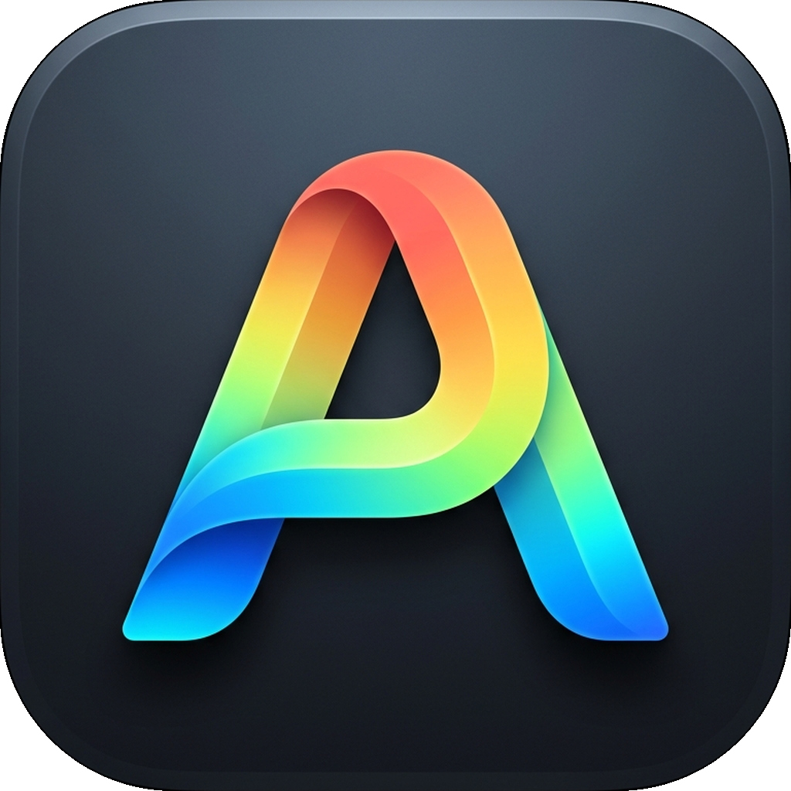

# AleClip 📋

<p align="center">
  
</p>

<p align="center">
  <strong>A modern, powerful native clipboard manager for macOS.</strong><br>
  Built natively with Swift 6, AppKit, and SwiftUI.
</p>

<p align="center">
  <a href="#features">Features</a> •
  <a href="#privacy--philosophy">Privacy & Philosophy</a> •
  <a href="#shortcuts">Keyboard Shortcuts</a> •
  <a href="#mcp-integration">MCP & AI Integration</a> •
  <a href="#building-from-source">Build from Source</a> •
  <a href="#license">License</a>
</p>

---

## 👨‍💻 Developed By

**Developed by SoftAI Yazılım (Mehmet Akif Çifçi)**  
*Designed to be completely free, private, and accessible for everyone.*

---

## 🛡️ Privacy & Philosophy

- **Zero Data Collection**: AleClip contains **no telemetry, no analytics, no remote tracking, and no external data selling**.
- **100% Local & Encrypted Storage**: All clipboard clips, collections, and settings are saved locally (`~/Library/Application Support/AleClip/`).
- **Screen-Sharing Privacy Shield**: Automatically conceals and blurs clipboard content during screen sharing, recordings, or presentations.
- **Sensitive Data Protection**: Automatically detects, masks, and protects secret tokens, API keys (`sk-`, `ghp_`, `AKIA`), credit cards, and password manager transient pasteboards.
- **Open Source (MIT)**: Permissive open-source license allows anyone to inspect, modify, fork, and build their own customized versions.

---

## ✨ Features (v2.1.0 - 2026)

1. **Unlimited Clipboard History**: Automatically save all copied text, images, links, files, code snippets, and colors without losing previous entries.
2. **Instant Search**: Instantly filter and search complete clipboard history across keywords, content, titles, and metadata (`⌘F`).
3. **OCR Search**: Automatically recognizes and indexes text inside screenshots and images using Apple Vision, making image text instantly searchable.
4. **Advanced Filtering**: Filter clipboard entries by application, date (Today, Yesterday, Past 7 Days, Past 30 Days), collections, and content categories.
5. **Pinboards and Collections**: Permanent, customizable collections (`⇧⌘N`) to organize frequently used text, links, code snippets, and research materials.
6. **Cloud Synchronization**: Synchronize clipboard history and collections securely across Mac, iPhone, iPad, and other devices via iCloud Drive or Cloud sync containers.
7. **Intelligent Clipboard**: Context-aware engine that detects the frontmost application (IDEs, browsers, communications, documents) and prioritizes relevant clips.
8. **AI and MCP Integration**: Native Model Context Protocol (MCP) server support for Claude Desktop, Cursor, VS Code, and Codex.
9. **Sequential Copy and Paste**: Queue mode (FIFO / LIFO) allowing you to copy multiple items into a queue and paste them sequentially in order.
10. **Plain-Text Pasting**: Paste text stripped of rich formatting or HTML using configurable shortcuts (`⇧↵` or settings).
11. **Clipboard Editing**: Full editing sheet (`⌘E`), quick renaming (`⌘R`), duplication, previewing (`Space`), and deletion.
12. **Quick Paste**: Global non-activating shortcut (`⌥V` / `Option + V`) opens history instantly without switching apps, plus direct number paste (`⌘1`–`⌘9`).
13. **Shared Collections**: Export and import shareable collection bundles (`.aleclipcollection`) for seamless collaboration.
14. **Advanced Privacy Controls**: Exclude selected apps, automatically mask sensitive information, and pause clipboard monitoring (`⌘T`).
15. **Screen-Sharing Privacy**: Automatically hides clipboard content during screen sharing, presentations, and screen recordings.
16. **Multiple-Item Pasting**: Select multiple clips (`⌘`-click or `⇧`-click) and combine them into a single paste operation with customizable delimiters.
17. **Source Application Tracking**: Captures and displays originating application icons, names, and bundle IDs for every copied item.
18. **Visual Clipboard Interface**: Sleek cards with thumbnails, high-res previews, application icons, syntax badges, and relative timestamps.
19. **Customizable Keyboard Shortcuts**: Complete set of configurable hotkeys for opening, searching, editing, collections, and monitoring.
20. **Cross-Application Compatibility**: Reliable paste simulation across browsers, office suites, terminals, IDEs, Slack, and native macOS apps.
21. **Background Operation**: Optimized event-driven loop with negligible CPU, battery, and memory overhead.
22. **Reliable Local Storage**: Atomic JSON writes, corrupt file recovery (`.bak` backups), and automated snapshot mechanisms.
23. **Advanced Content Recognition**: Auto-detection of URLs, emails, colors (HEX/RGB), file paths, and programming languages (Swift, Python, JS/TS, HTML, SQL, Shell, JSON).
24. **Data Export and Backup**: Quick local backups, JSON import/export, and collection archive sharing.
25. **Modern macOS Integration**: Native Sonoma/Sequoia SwiftUI and AppKit design, Apple silicon optimization, and dark mode support.

---

## ⌨️ Keyboard Shortcuts

| Action | Shortcut |
| :--- | :--- |
| **Open clipboard history** | `Option + V` (`⌥V`) |
| **Search clipboard** | `Command + F` (`⌘F`) |
| **Edit selected item** | `Command + E` (`⌘E`) |
| **Rename selected item** | `Command + R` (`⌘R`) |
| **Create new collection** | `Shift + Command + N` (`⇧⌘N`) |
| **Create new text item** | `Command + N` (`⌘N`) |
| **Pause clipboard monitoring** | `Command + T` (`⌘T`) |
| **Preview selected item** | `Space` |
| **Direct Quick Paste** | `Command + 1` through `Command + 9` |
| **Paste as Plain Text** | `Shift + Return` (`⇧↵`) |
| **Undo last deletion** | `Command + Z` (`⌘Z`) |
| **Dismiss panel** | `Escape` (`Esc`) |

---

## 🤖 Model Context Protocol (MCP) Integration

AleClip can run as a native MCP server over `stdio` to provide AI tools with real-time access to your clipboard and OCR index.

To configure Claude Desktop or Cursor, add the following to your configuration:

```json
{
  "mcpServers": {
    "aleclip": {
      "command": "/Applications/AleClip.app/Contents/MacOS/aleclip",
      "args": ["--mcp"]
    }
  }
}
```

### Supported MCP Tools:
- `get_recent_clips(limit: Int)`: Retrieves the most recent clipboard entries.
- `search_clipboard(query: String)`: Searches across history, metadata, and OCR image text.
- `add_clip(text: String, title: String?)`: Appends a new item into your clipboard history.
- `get_collections()`: Lists all organized pinboards and collections.

---

## 🛠️ Building from Source

### Prerequisites

- macOS 14.0 or newer
- Apple Command Line Tools (`swiftlang-6.0` or newer) or Xcode

### Build & Run Tests

```bash
# Navigate to repository
cd aleclip

# Build debug binary
swift build

# Run unit tests
swift run test-runner
```

### Packaging `.app` and `.dmg`

```bash
./scripts/package_app.sh
```

The output files will be created at:
- `AleClip.app` (Installed to `/Applications/AleClip.app`)
- `AleClip.dmg` (Distribution disk image)

---

## 📄 License

This project is licensed under the MIT License — see the [LICENSE](LICENSE) file for details.  
Created and maintained by SoftAI Yazılım (Mehmet Akif Çifçi).
