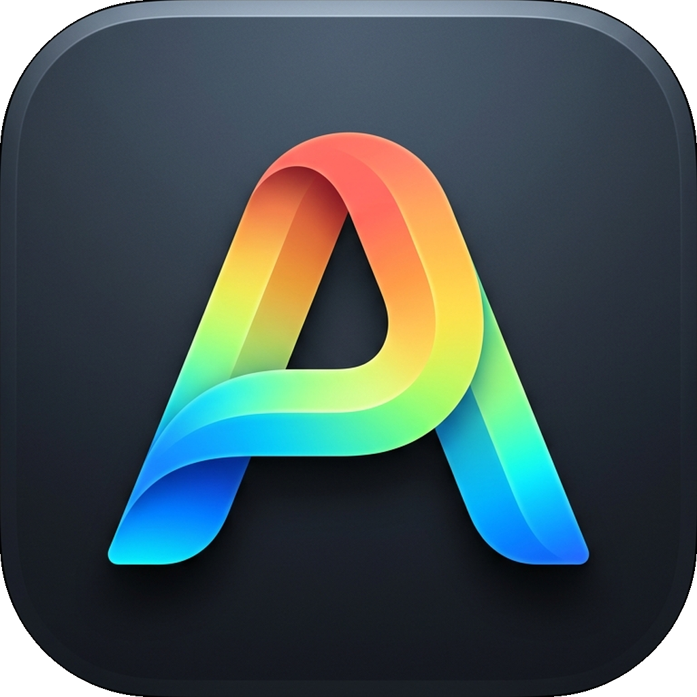

# AleClip 📋

<p align="center">
  
</p>

<p align="center">
  <strong>A modern, lightweight native clipboard manager for macOS.</strong><br>
  Built natively with Swift 6, AppKit, and SwiftUI.
</p>

<p align="center">
  <a href="#features">Features</a> •
  <a href="#privacy--philosophy">Privacy & Philosophy</a> •
  <a href="#shortcuts">Keyboard Shortcuts</a> •
  <a href="#building-from-source">Build from Source</a> •
  <a href="#license">License</a>
</p>

---

## 👨‍💻 Developed By

**Developed by SoftAI Yazılım (Mehmet Akif Çifçi)**  
*Designed to be completely free, private, and accessible for everyone.*

---

## 🛡️ Privacy & Philosophy

- **Zero Data Collection**: AleClip contains **no telemetry, no analytics, no remote tracking, and no internet access**.
- **100% Local Storage**: All clipboard clips and settings are encrypted/persisted strictly on your local disk (`~/Library/Application Support/AleClip/`).
- **Free for Everyone**: Free to use, free to share, and free to fork for personal or organizational workflows.
- **Open Source (MIT)**: Permissive open-source license allows anyone to inspect, modify, fork, and build their own customized versions.

---

## ✨ Features (v2.0.1 - 2026)

- **Instant Undo (`⌘Z`) & Toast Banner**: Immediately recover accidentally deleted notes or clips with `⌘Z` or by clicking the notification banner.
- **Recently Deleted (Trash Bin)**: Dedicated filter tab storing deleted notes with one-click restore (`↵` or button) and permanent purge options.
- **Non-Activating Floating Panel**: Slides up smoothly from the bottom of your screen using `⌥V` (or your chosen shortcut) without stealing window focus from your active apps.
- **Smart Multi-Monitor Detection**: Automatically identifies which screen your mouse cursor is on and positions the panel on that display.
- **Click-Away Auto-Dismiss**: Seamlessly dismisses the panel if you click outside on desktop/other windows or switch apps.
- **Direct Quick Paste (`⌘1`–`⌘9`)**: Instantly paste any of the first 9 cards directly into the active app with a single keystroke.
- **RunLoop Common Mode Polling**: Polling timer runs on `.common` RunLoop mode to ensure copies during window dragging, scrolling, or menu tracking are never dropped.
- **Large Clip Safety Protection**: Safely caps massive text dumps at 250,000 characters to prevent SwiftUI main-thread UI freezing.
- **SSD Write Debouncing**: Groups rapid consecutive copies with a 0.4s debounce, preserving SSD write cycles and MacBook battery life.
- **Automatic Corrupt File Recovery**: Safely archives any corrupt history files to `.bak` backups rather than discarding clipboard history.
- **Native Audio Feedback**: Plays subtle macOS system audio (`Tink` on copy, `Pop` on paste) when sound effects are enabled.
- **Subtle Background Watermark**: Clean, unobtrusive `"ALE"` watermark rendered on the panel background layer.
- **Multi-Type Clipboard Support**:
  - Plain Text & Rich Text (RTF)
  - HTML & Markdown snippets
  - High-resolution Images (PNG, TIFF, JPEG)
  - URLs and Web Links (with one-click browser opening)
  - File Paths & File URLs
  - Hex / RGB Color Codes (with live swatch previews)
- **Quick Look (`Space`)**: Press `Space` on any card for an instant enlarged preview of text, high-res images, links, or colors.
- **Direct Paste (`↵`)**: Synthesizes `⌘V` directly into your frontmost application using native macOS Quartz Event Services.
- **Plain Text Paste (`⇧↵`)**: Strips formatting and pastes pure unformatted text on the fly.
- **Card-Based Settings Window (`⌘,`)**:
  - **General**: Configurable history limits (50–1000 items), direct paste toggles, accessibility status checks, sound effects, and Language picker (System / English / Türkçe).
  - **Shortcuts**: Configurable global hotkey (`⌥V`, `⌘⇧V`, `⌃⌥V`, `⌥Space`) and built-in shortcuts guide.
  - **Exclusions**: Block sensitive apps (1Password, Bitwarden, Keychain, etc.) from being recorded, with an interactive macOS app picker.
  - **Backup & Restore**: Export history to a standard `.json` file, restore with automatic deduplication, or prune unpinned items.
  - **About**: Live clip counter, developer credits, and privacy highlights.
- **Full Turkish & English Localization**: Seamless bilingual support across all panels, menus, settings, and shortcuts with dotted/dotless `I/ı/İ/i` search case-folding.
- **Custom URL Scheme**: Control AleClip from scripts, terminal, or automations via `aleclip://toggle`, `aleclip://show`, `aleclip://settings`, and `aleclip://about`.
- **Menu Bar Agent**: Lightweight status bar item showing recent clips, pin states, and quick access to Settings or History Purge.

---

## ⌨️ Shortcuts Reference

| Shortcut | Action |
| :--- | :--- |
| `⌥V` | **Toggle Panel** (Open / Dismiss AleClip bottom panel) |
| `←` `→` | **Navigate** between clipboard cards |
| `↵` (Return) | **Paste** selected clip into active application |
| `⌘1`–`⌘9` | **Quick Paste** card 1 to 9 directly into active application |
| `⇧↵` (Shift+Return) | **Paste as Plain Text** (strips rich text / HTML styling) |
| `Space` | **Quick Look Preview** (fullscreen card inspection) |
| `⌘E` | **Edit Clip** (modify text content or assign custom title) |
| `⌫` (Delete) | **Delete Clip** from history |
| `⌘,` | **Open Settings** |
| `Esc` | **Close** panel without pasting |

*(You can customize the global activation shortcut from Settings $\rightarrow$ Shortcuts).*

---

## 🛠️ Building from Source

### Requirements
- **macOS 14.0 (Sonoma)** or later
- **Apple Command Line Tools** (`swiftlang-6.0` or newer) or Xcode

### Build & Run Tests
```bash
# Clone or navigate to the repository
cd aleclip

# Build debug binary
swift build

# Run unit tests
swift run test-runner
```

### Packaging `.app` and `.dmg`
The repository includes an automated release packaging script that compiles in release mode, generates Apple `.icns` icons, signs the bundle with ad-hoc signatures, strips quarantine attributes, and builds a distribution DMG:

```bash
./scripts/package_app.sh
```

The output files will be created at:
- `AleClip.app` (Installed to `/Applications/AleClip.app`)
- `AleClip.dmg` (Distribution disk image with drag-and-drop `/Applications` link)

---

## 🪟 Windows Version

Looking for the native Windows edition (`AleClip.exe`)?  
Visit the dedicated repository: [**themanoftalent/aleclip-windows**](https://github.com/themanoftalent/aleclip-windows)

---

## 📄 License

This project is licensed under the **MIT License** — see the [LICENSE](LICENSE) file for details.  
Created and maintained by **SoftAI Yazılım (Mehmet Akif Çifçi)**.
